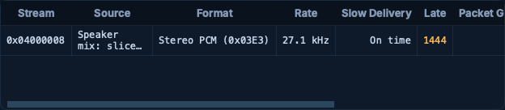

# Issue #6051 reproduction evidence

Product head: `d0ead0a358fa4f3ae046063fb7016352616f01d3`.
Unfixed baseline: `9450f3089012e2c98c9fb361027384e2f827d05d`.

## Independent check of the reporter's captures

Use the [public evidence attachment](https://github.com/user-attachments/files/34010447/issue-6051-evidence.zip) from [the reporter's follow-up](https://github.com/aethersdr/AetherSDR/issues/6051#issuecomment-6439067026). Its SHA-256 is `0574c341669b3f4d11704e7e4307465852779da41726a6d492a577324fb0c5d9`.

Extract it under `evidence/issue-6051-evidence/` beside `independent_pcap_check.py`, then run that script. It independently parses the capture framing and matches unique Opus timestamps and FFT/waterfall fragment identities across the radio, tunnel and client captures. It does not rely on treating a four-bit sequence jump as proof of loss.

| Class | Matching packets at client | Truly missing | Reordered | Old sequence errors | New missing / gap events |
|---|---:|---:|---:|---:|---:|
| Opus | 5907 | 0 | 154 | 432 | 0 / 0 |
| FFT | 1480 | 0 | 137 | 403 | 0 / 0 |
| Waterfall | 656 | 0 | 9 | 26 | 0 / 0 |

The final column comes from replaying the captured order and timing through the production `VitaRxReorder` helper. `capture-order.json` and `replay_capture.cpp` preserve that reproduction. The pcaps contain truncated payloads, so this replay proves ordering/loss accounting; full audio decoding is covered separately below.

## Real-radio before and after

Hardware: FLEX-6700, firmware 4.3.16.42034. All sessions were receive-only. Real TCP status and UDP media came from the physical radio; no simulator supplied the stream.

`real_radio_relay.py` is the opt-in forwarding harness used for the final Linux and Windows checks. Start it with `python3 real_radio_relay.py <proof-dir> <radio-ip>`, connect AetherSDR by IP to the relay's observed `listen` address in `relay-ready.json`, and control it with `<proof-dir>/relay-control.json`:

- `{"mode":"pass"}`: forward actual packets unchanged.
- `{"mode":"swap"}`: hold every eightieth selected packet until its successor, with a 20 ms maximum hold. No intentional drops.
- `{"mode":"loss"}`: drop a single selected packet at count modulo 200 = 100 and a six-packet burst at count modulo 600 = 140..145.
- `{"mode":"pass","force_opus":true}`: request Opus for this session by rewriting only its remote-RX compression request. This does not persist a preference.
- `{"mode":"pass","stop":true}`: stop the harness.

The harness targets FFT/waterfall and the first remote speaker-audio stream (`0x04000008`) used in these runs. Verify the actual stream ID when adapting it to another session. Its `input_errors` counter checks the incoming radio sequence; `dropped`, `swaps` and `naive_errors` record the imposed delivery changes. It is a controlled test harness, outside the application's default test graph. Use one test client at a time and leave transmit automation disabled.

Capture the application's decoded input and speaker output with the agent automation bridge (`capture_audio`, value `3000 raw,final`), and save network diagnostics with `dump_tree`, filter `networkStatusBlock`. End each impairment phase in `pass` mode and allow the 30 ms reorder deadline to drain before comparing counters.

### Unfixed macOS baseline

No radio-side sequence breaks and no relay drops. In a roughly three-second PCM capture the raw tap contained 541 chunks of 128 frames, 14 chunks of 256 frames, and 7 chunks of 1152 frames. The latter two shapes contain concealment prepended to a genuine 128-frame packet:

`14 * (256 - 128) + 7 * (1152 - 128) = 8960 unnecessary frames = 373.3 ms at 24 kHz`.

Seven swapped pairs therefore manufactured seventy packet units of concealment, despite every original packet arriving. A simple swapped pair produces three false errors and `1 + 8 + 1` concealment units.

### Fixed application

| Platform / phase | Relay measurement | Application / raw-tap measurement |
|---|---|---|
| Mac PCM swaps | 70 audio pairs swapped; zero drops/input errors | No new audio loss; overall network loss stays zero in this phase |
| Mac Opus swaps | 102 pairs swapped; zero drops/input errors | No new audio loss; 302 raw chunks, all 240 frames, with no added concealment |
| Linux PCM swaps | 124 pairs swapped; zero drops/input errors | Zero reported loss; 1503 raw chunks, all 128 frames |
| Windows PCM swaps | At least 96 pairs swapped; zero drops/input errors | Zero reported loss; 1488 raw chunks, all 128 frames |
| Linux real loss | Audio / FFT / WF drops: 98 / 21 / 27 | Exact counter match; capture has eight single-packet and three six-packet concealments |
| Windows real loss | Audio / FFT / WF drops: 188 / 47 / 53 | Exact counter match; capture has seven single-packet and three six-packet concealments |
| Mac Opus real loss | Intentional singles and six-packet bursts | Capture has four single-packet and one six-packet concealments: 2400 extra frames |

The short audio capture windows are subsets of the longer loss phases; their concealment counts are not the whole-phase packet totals. Spectrum, waterfall and live meters continued updating, and reconnect was checked. Temporary Windows test access was scoped to the exact executable and radio/relay addresses, then the original rules were restored and read back.

## Focused regression tests

Nine tests pass natively on macOS ARM64, Linux and Windows:

`vita_rx_reorder_test`, `vita_rx_reorder_audio_test`, `vita_sequence_loss_log_test`, `remote_audio_rx_sequence_restart_test`, `packet_loss_concealment_test`, `vita_packet_admission_test`, `panadapter_late_packet_test`, `panadapter_dbm_range_test`, `hl2_link_stats_model_seam_test`.

They drive the production ingest without sockets and include real Opus encoding/decoding, bit-identical ordered-versus-reordered PCM, wrap/duplicate handling, real gaps of 1..15 packets, the existing eight-packet concealment cap, disabled concealment, deadline expiry, route retirement, DAX adoption, and payload bounds. Mutation checks rejected disabled loss accounting (34 failing checks) and immediate deadline expiry (373 failing checks).

The detailed Mac before/after impairment captures use the first implementation commit `448051a31185a4092df356e703f495e10a288411`. The final two commits add route and timing retirement guards. The final Mac build was rebuilt, retested and verified with direct physical-radio RX; final Linux/Windows impairment tests and affected-source hash comparisons use `d0ead0a358fa4f3ae046063fb7016352616f01d3`. This is focused validation, not a claim that the full default CI graph has passed.

## Retired timing row

Before retirement was fixed, a stream initially treated as speaker PCM and later classified as DAX remained in the speaker timing table. Its old arrival timestamp caused the displayed deficit to grow indefinitely. The final physical-radio Mac session shows one active speaker row, On time, with no obsolete DAX timing row. The production-ingest regression checks this immediately on DAX adoption and on stream restart.

